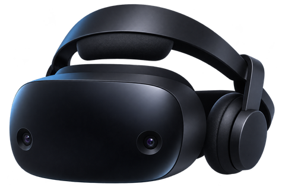

# Odyssey+ Volume Buttons With Oasis Driver



Use the physical volume buttons on a Samsung Odyssey+ to control Windows audio.

This headset still rocks with the Oasis driver. In my setup, the hardware volume buttons stopped working. This little app makes the Odyssey+ buttons control the volume of your default Windows audio output.

## Compatibility

- The app targets the USB interface of the **Samsung Odyssey+**.
- Tested on **64-bit Windows 11, version 25H2**, with a Samsung Odyssey+ using Oasis and SteamVR. [Oasis Driver for Windows Mixed Reality](https://store.steampowered.com/app/3824490/Oasis_Driver_for_Windows_Mixed_Reality/)
- **SteamVR** is optional for volume control.

## Run the app

1. [Download the Windows ZIP](https://github.com/PeperMarkreel/OdyseyVolumeButtons/releases/latest) and extract `OdysseyVolume.exe`, or [build it from source](#build-from-source).
2. Put the executable in a folder where you plan to keep it, then double-click it.
3. Choose a startup mode on the first launch. Connect the headset and try its volume buttons once the app is running. Right-click the speaker icon in the Windows notification area to see the connection or volume status. If the icon is hidden, look under the notification area's up arrow.

The app runs as your Windows user and works without an installer or administrator rights.

## Start automatically

On the first launch, choose when to run the app. To change your choice later, right-click the tray icon and select **Startup options…**. The window shows your current startup settings.

| Startup option | What happens |
| --- | --- |
| **Start and stop with SteamVR** | Starts the next time SteamVR opens. A SteamVR-started instance exits when SteamVR shuts down. |
| **Start on user logon** | Starts now and at future Windows sign-ins. |
| **Just run once (this session)** | Runs for the current session and leaves both autostart settings off. You can still open the app manually. |

Existing autostart settings carry over when you upgrade. If the app is already running, a second launch keeps the existing instance. An instance opened manually or at Windows sign-in stays open when SteamVR closes.

If you move the executable, save **Just run once (this session)** and then reselect your autostart option from the new location to update the saved path. To uninstall, save **Just run once (this session)**, choose **Exit** from the tray menu, then delete the executable.

## Build from source

Install the .NET 10 SDK for Windows. [Download the .NET SDK](https://dotnet.microsoft.com/en-us/download/dotnet/10.0)

Run the build script from the repository root in PowerShell.

```powershell
.\app\build.ps1
```

The script builds `outputs\OdysseyVolume.exe`. Close the app before rebuilding into the same location. The SDK is required for the build. The executable runs on Windows using .NET Framework.

## Troubleshooting

- **The tray says “Waiting for Odyssey+”.** Reconnect the headset's USB plug and check whether the tray status changes. The app retries automatically.
- **A button changes the wrong device's volume.** Choose the intended device in Windows sound settings. The app looks up the default multimedia output on each press.
- **SteamVR autostart fails.** Check that SteamVR is installed through Steam, then enable the option again from the tray.

If you're still stuck, [open an issue](https://github.com/PeperMarkreel/OdyseyVolumeButtons/issues/new) with your Windows version, headset model, and the message shown in the tray. For a SteamVR issue, also include your SteamVR version and how the app was started.
